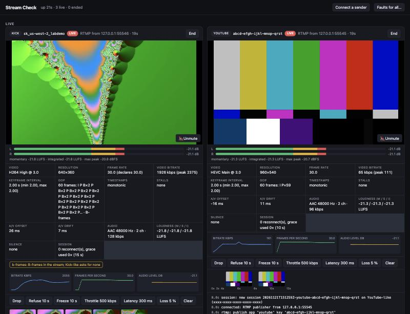

# Stream Check

A local, fake streaming platform for testing live-video senders. Point OBS, ffmpeg, a phone app or
your own encoder at it as if it were Twitch, YouTube or Kick, and see what actually arrives:
a live preview you can hear, every parameter measured, the rules a real platform would enforce,
and failures on demand. Everything is also a JSON API and a CLI, so a script (or an AI agent) can
run a streaming test and read the verdict without looking at a screen.

- **Ingest:** RTMP, RTMPS (self-signed certificate), SRT listener (optional passphrase, `streamid`),
  WHIP (HTTP endpoint, bearer token). H.264 and AAC; HEVC, AV1, VP9, VP8 and Opus the Enhanced RTMP way;
  H.264, HEVC, AV1, VP9, VP8 and Opus over WHIP.
- **Several streams at once**, told apart by platform and stream key, each its own session.
- **Platform profiles** (Twitch-, YouTube- and Kick-like, plus an open one): they refuse wrong keys, flag
  streams that break the platform's rules (codec, bitrate, keyframe interval, resolution, audio) and keep
  a session alive for a reconnect grace period, as platforms do.
- **Fault injection** per stream, from the UI, the API and the CLI: drop the connection, refuse new
  ones for N seconds, freeze reading, throttle, add latency, lose packets.
- **See and hear it** in a browser (no plug-ins): live preview with sound and level meters, stats with
  graphs, a thumbnail timeline, an event log.
- **Evidence:** every session is recorded in the protocol's own container (FLV, MPEG-TS or Matroska)
  and ends with a JSON report, with ffprobe's verdict that the recording plays.



## Install and run

You need a Rust toolchain ([rustup.rs](https://rustup.rs)). ffmpeg is optional but recommended: with it
on your `PATH` you get thumbnails, loudness (LUFS) and peak meters, and recordings are checked with ffprobe.

```sh
git clone https://github.com/Lightair-Project/stream-check
cd stream-check
cargo run --release
```

It prints the addresses to use, with this machine's LAN address so phones can reach it. Open
<http://localhost:8890> for the UI. Ports (all changeable, see `--help`):

| What | Default |
|---|---|
| Web UI, API, WHIP | `8890` (TCP) |
| RTMP | `1935` (TCP) |
| RTMPS | `1936` (TCP), certificate in `<data>/tls/cert.pem` |
| SRT | `9000` (UDP) |

The Android emulator reaches this machine as `10.0.2.2`; the UI lists that address too, with QR codes
for the LAN addresses ("Connect a sender").

### Sending to it

The first part of the path is the platform (`twitch`, `youtube`, `kick`, or anything else: `open`):

```sh
# RTMP: server rtmp://<host>:1935/<platform>, key <key>
ffmpeg -re -f lavfi -i testsrc2=size=1280x720:rate=30 -f lavfi -i sine=frequency=440 \
  -c:v libx264 -g 60 -bf 0 -pix_fmt yuv420p -c:a aac -ar 48000 -f flv rtmp://localhost:1935/open/mytest

# SRT (needs an ffmpeg built with libsrt; OBS and most hardware encoders have it)
ffmpeg -re ... -f mpegts "srt://localhost:9000?streamid=open/mytest"

# WHIP (any WHIP client): POST an SDP offer to
http://localhost:8890/whip/open/mytest
```

In OBS: *Settings → Stream → Custom*, server `rtmp://<host>:1935/twitch`, key `live_123456789_anything`.

Stream keys are checked like the platform would: a Twitch-like platform wants `live_…`, a YouTube-like one
`xxxx-xxxx-xxxx-xxxx-xxxx`, a Kick-like one `sk_…`; `open` takes anything. Start with `--any-key` to accept
any key on every platform, or `--accept-key twitch=live_mykey` to accept only certain keys.

## The UI

One card per stream: a live preview (decoded in the browser with WebCodecs from the NAL units the lab
forwards: Chrome, Edge and Safari; HEVC, AV1 and VP9 streams need the browser to decode them, and the preview falls
back to thumbnails when it can't), an unmute button, level meters, and stats: codec, profile and level,
resolution, measured frame rate, bitrate, keyframe interval, GOP structure, B-frames, timestamp
monotonicity and gaps, A/V offset and drift, stalls, audio format, loudness (momentary, short-term, integrated
LUFS), peaks, silence, reconnects and grace-period use, what the video bitstream says (broadcast performance
metrics, latency against the sender's clock, colour tags, level limits, captions, IDRs and SPS changes: see
"The video bitstream"), and every platform rule broken. Under the card:
graphs, fault buttons, a thumbnail timeline and the event log.

## Platform profiles

| Profile | Video | Bitrate | Keyframes | Audio | Grace |
|---|---|---|---|---|---|
| `twitch` | H.264, no B-frames | 8500 kbps | every 2 s | AAC 44.1/48 kHz | 30 s |
| `twitch-dual` | Twitch Dual Format: H.264 (HEVC read), no B-frames, multitrack (below) | 12500 kbps across the tracks | every 2 s, every track | AAC 44.1/48 kHz | 30 s |
| `youtube` | H.264, HEVC, AV1 | 51000 kbps | every 4 s | AAC, Opus | 10 s |
| `kick` | H.264, no B-frames | 8000 kbps | every 2 s | AAC 44.1/48 kHz | 15 s |
| `open` | anything | no limit | any | anything | 10 s |

Every profile also holds the video bitstream to these (rules named in the report; `track-…` for a multitrack
track beyond the first):

| Rule | Level | Profiles | When |
|---|---|---|---|
| `video-profile` | error | `twitch`, `twitch-dual`, `kick`: H.264 Baseline, Main, High, HEVC Main; `youtube`: also HEVC Main 10 | the codec profile isn't one the platform takes |
| `video-level` | warning | all | the SPS's level is too low for the picture size, the frame rate, the peak bitrate or the reference frames |
| `video-range` | warning | all but `open` | the picture is tagged full range; platforms expect limited (TV) range |
| `video-hdr` | warning | `twitch`, `twitch-dual`, `kick` | a PQ or HLG transfer on a platform that shows SDR |
| `bpm-missing` | error | `twitch-dual` | the latest keyframe on a track had no broadcast performance metrics SEI in front of it |
| `dual-frame-rate` | warning | `twitch-dual` | a declared (VUI) frame rate other than 24, 25, 30, 48, 50 or 60 |
| `dual-captions` | warning | `twitch-dual` | captions on some tracks but not all (IVS wants SEI copied onto every track) |

**Why `twitch` doesn't require BPM and `twitch-dual` does:** Amazon IVS's multitrack guide (what Twitch's Enhanced
Broadcasting runs on) lists broadcast performance metrics as a *required feature of multitrack video*, and puts
"broadcast performance metrics do not precede every IDR on every track" among the reasons the *multitrack* ingest
disconnects a client. Nothing in it, or in Twitch's own broadcast guidelines, asks it of an ordinary one-track RTMP
stream, and Twitch takes such streams from encoders that never write BPM (ffmpeg, most hardware encoders). So
`twitch` reports BPM when it's there and checks nothing; `twitch-dual` (Enhanced Broadcasting) fails a stream
whose keyframes lack it.

These are approximations of the platforms' published limits, for testing; they aren't a promise about the
platforms. A stream that disconnects stays a *session* for the grace period (shown as "waiting"); if the same
key publishes again within it, the session continues (new recording segment, `reconnects` and `grace_uses`
go up); otherwise the session ends and its report is written. `--grace <s>` overrides the profiles.

## Enhanced RTMP multitrack and Twitch Dual Format

Stream Check reads Enhanced RTMP v2 ([veovera/enhanced-rtmp](https://github.com/veovera/enhanced-rtmp)) as well
as classic FLV tags:

- **connect:** the client's `capsEx`, `fourCcList`, `videoFourCcInfoMap` and `audioFourCcInfoMap` are kept
  (the report's `client.enhanced_rtmp`, and an event). The `_result` says the lab supports multitrack and ModEx
  (`capsEx` 0x06) and decodes `avc1`, `hvc1`, `av01`, `vp09`, `vp08`, `mp4a` and `Opus`.
- **video:** extended headers with ModEx (TimestampOffsetNano), command frames and Metadata skipped, and
  `Multitrack` in all three layouts (`OneTrack`, `ManyTracks`, `ManyTracksManyCodecs`), with SequenceStart,
  CodedFrames, CodedFramesX and SequenceEnd in each track. A classic tag is track 0.
- **AV1, VP9 and VP8:** the sequence start's AV1CodecConfigurationRecord or VP codec configuration record is read,
  and the coded frames' own bitstream says the rest: AV1's sequence header (profile, level, tier, size, bit depth,
  colour, declared frame rate) and which temporal units hold a shown key frame; a VP9 or VP8 key frame's header
  (profile, size, bit depth), superframes included. Key frames are counted from the bitstream, not the tag's frame
  type. The stats get the WebCodecs codec string (`av01.0.08M.08`, `vp09.00.40.08`, `vp8`) for the preview.
- **audio:** the same with `Multitrack` audio; classic AAC is track 0.
- **per track:** every track beyond the first is analysed on its own (codec, profile, size, frame rate,
  bitrate average and peak, keyframe interval, B-frames, timestamps) and recorded as its own playable file,
  `segNN-trackN.mkv`, beside the main recording. The report's `tracks` lists them, with `total_video_kbps`.
- **across tracks:** each track's keyframes are held against track 0's (aligned within one frame of the slower
  track), its start against track 0's (one timestamp base, within 1 s), and its timestamps must rise.
- **the key:** the stream name's query is reported by parameter name only (`client.key_query`, and whether
  `clientConfigId` is there); values are never kept.
- **onMetaData:** `videoTrackIdInfoMap` and `audioTrackIdInfoMap` are kept when sent (`track_maps`).
- **the web UI:** a multitrack session's card shows each track beyond the first with its own live picture
  (`/ws/preview/<session>?track=N`) and its stats, under the main picture (track 0).

The `twitch-dual` profile (`rtmp://host:1935/twitch-dual/<key>`) adds Twitch Dual Format's rules: at least one
16:9 and one 9:16 picture, the largest 9:16 one 1080x1920, track 0 the largest landscape one, every track's
keyframes every 2 s, the picture's total against 12.5 Mbps, AAC sound.

**A stand-in configuration service:** `POST /api/v3/GetClientConfiguration` on the HTTP port answers a fixed
Dual Format plan for a request in OBS's form (two canvases, a stream key in `authentication`): each canvas as one
track (6000 and 5000 kbps CBR, 2 s keyframes, no B-frames, VideoToolbox's encoder ids on macOS, x264's
otherwise), AAC at 160 kbps, and an `ingest_endpoints` URL pointing at this lab's `twitch-dual`. The field names
follow OBS's reading of Twitch's answer; the values are the lab's own, not Twitch's.

**A test sender:** `tools/ertmp-send.py` publishes a two-picture FLV (as ffmpeg 8 writes one) in any of the three
multitrack layouts, with ModEx, multitrack audio, track maps and a key query; its header says how. ffmpeg 8 itself
sends the `OneTrack` layout libobs uses (`ffmpeg ... -map 0:v -map 1:v -map 2:a ... -f flv rtmp://...`).

## The video bitstream

The analyzer reads the H.264 and HEVC bitstream of every track (track 0 in `stats.video`, the others in
`tracks.tracks[].video`), whatever the ingest. What it adds to `video`:

- **`sps`** (the parameter set in force) also has `bit_depth_chroma`, `ref_frames` (H.264 max_num_ref_frames,
  HEVC's decoded picture buffer size), `high_tier` (HEVC), `vui` (whether the SPS has VUI) and `colour`:
  `video_format`, `full_range` (absent: not tagged, which means limited), `primaries`, `transfer`, `matrix` (the
  H.273 codes) with `primaries_name`, `transfer_name`, `matrix_name` ("BT.709", "PQ (SMPTE ST 2084)", "HLG"…), and
  `chroma_loc_top`/`chroma_loc_bottom`. HEVC's `declared_fps` now comes from its VUI too.
- **`bpm`**: the broadcast performance metrics, three "user data unregistered" SEI messages (timestamp `ts`, session
  metrics `sm`, encoded rendition metrics `erm`, as Amazon IVS defines them) that Twitch Enhanced Broadcasting
  wants in front of every IDR on every track. `present`; `keyframes_checked`, `keyframes_with_all`,
  `keyframes_missing` and `every_keyframe` (a keyframe is an IDR or a picture the container marks key; the three
  must come before its first slice); `last_missing` (what the latest keyframe lacked: `ts`, `sm`, `erm`);
  `ts_messages`, `sm_messages`, `erm_messages`; `off_keyframe` (BPM on other pictures), `after_slice` (BPM after
  the slice, so not "in front"), `malformed` (unreadable, or not in the form IVS reads: one RFC 3339 time of event
  4, four session and three rendition counters); `last_time` (the latest timestamp as sent) and `last_event`;
  `time_backwards`; `session` (`rendered`, `lagged`, `dropped`, `output`: the latest message's counts, since the
  track's keyframe before) and `session_total`; `rendition` (`input`, `skipped`, `output`) and `rendition_total`;
  `output_mismatches` (keyframes whose rendition `output` isn't the number of pictures that arrived since the
  keyframe before). Events: `bpm` (first seen), `bpm-missing` (a keyframe without them, once BPM has been seen; the
  first five, then every hundredth), `bpm-counters`, `bpm-malformed`, `bpm-form`.
- **`latency`**: when the stream carries the sender's wall clock (the BPM timestamp, the encoder's "packet
  interleave" time), the arrival time minus that clock: `source` ("bpm"), `samples`, `last_ms`, `min_ms`,
  `avg_ms`, `max_ms`; the graph series has `latency_ms` (the latest value). It is the time from the sender handing
  the picture to its connection to the lab having it whole, so the send queue and the network; it means that only
  when both clocks agree (the same machine, or both synchronised by NTP).
- **`captions`**: CEA-608 and CEA-708 in ATSC A/53 SEI (registered user data, "GA94"): `present`,
  `sei_messages`, `cea608_field1` and `cea608_field2` (byte pairs with content), `cea708_packets`, `channels_608`
  ("CC1"…"CC4", from control codes), `services_708`, `recent_text` (the latest CEA-608 field-1 text, 80
  characters) and `last_at_s`. Event `captions` when they first arrive.
- **`bitstream`**: `idr` (pictures with an IDR), `keyframes_not_idr` (marked key without an IDR: HEVC CRA, or an
  H.264 I picture with a recovery point; event `keyframe-not-idr`), `idr_not_marked` (an IDR the container doesn't
  mark key), `pictures_i`/`pictures_p`/`pictures_b` (by first slice), `sps_changes` (event `sps-changed`, saying
  which fields changed: size, profile, level, bit depth, colour, frame rate…), `inband_sps` and
  `inband_sps_differs` (SPS sent inside pictures, and those that differ from the one before),
  `bad_nal_lengths` (pictures whose NAL lengths don't add up: start codes where lengths belong; event
  `nal-lengths`), `sei` (SEI messages by payload type, "recovery point (6)": 12), `user_data` (other user data
  unregistered messages: `uuid`, `count`, and `text` when it reads as text, as encoders write their name and
  settings), `colour_warnings` and `level_warnings` (below).
- **Colour warnings** (event `video-colour`): no VUI, no video signal type or no colour description; tags left
  "unspecified"; BT.601 on an HD picture; primaries and matrix of different families; PQ or HLG without BT.2020
  primaries or below 10 bits; the RGB matrix with subsampled chroma; luma and chroma at different depths.
- **Level warnings** (event `video-level`): the level's limits against the picture (H.264 Table A-1: frame size in
  macroblocks and on a side, macroblocks a second, the peak bitrate against MaxBR with the profile's factor,
  reference frames against the picture buffer; HEVC: luma samples a picture and on a side, luma samples a second,
  MaxBR by tier, the picture buffer). The frame rate is the measured one (3% slack), the bitrate the peak over 2 s
  (10% slack), so they are a strong hint, not a conformance test.

## Fault injection

Per stream key (the same key on any platform), or `*` for every stream; from the UI buttons, the API or the CLI.

| Fault | Effect |
|---|---|
| `drop` | closes the connection now (sender reconnects, or doesn't) |
| `refuse <s>` | closes it and refuses new connections for N seconds (RTMP: `NetStream.Publish.Failed`, WHIP: 503) |
| `freeze <s>` | stops reading for N seconds: a dead network that never says so (TCP back-pressure builds) |
| `throttle <kbps>` | paces reading to this rate; the sender's own send queue fills, as on a slow link |
| `latency <ms>` | delays the lab's replies to the sender (RTMP command responses and acks) |
| `loss <pct>` | drops this share of received SRT datagrams *after* SRT's own recovery, as if unrecoverable |

`throttle`, `latency` and `loss` accept `--for <s>` to expire by themselves. The lab sits at the receiving
end, so these are approximations of network trouble, not a network emulator; for packet-level loss and delay
use a tool like `dnctl`/`pfctl` (macOS) or `tc netem` (Linux) in front of it.

RTMP and RTMPS connections get a fixed 64 KB kernel receive buffer, so the backlog of a `throttle` or
`freeze` stays in the sender's own buffers, where it can see it and adapt, as on a slow uplink. With the
system's auto-tuned buffer (megabytes on localhost) a throttled stream's seconds of backlog sat unread at
the lab: the sender saw nothing wrong, and the picture arrived late and then in a burst.

```sh
stream-check fault mytest drop
stream-check fault mytest throttle 800 --for 20
stream-check fault '*' refuse 10
curl -X POST localhost:8890/api/faults/mytest -d '{"throttle_kbps":800,"for_s":20}' -H 'Content-Type: application/json'
```

## For scripts and agents

```sh
stream-check wait-for mytest --live --timeout 30     # exit 0 when media is flowing (prints a summary), 1 on timeout
stream-check wait-for mytest --ended --timeout 120   # exit 0 when the session has ended
stream-check report latest --summary                 # a few lines of text; exit 3 if problems were found
stream-check report mytest                           # the whole JSON report
stream-check events mytest --kind violation          # event log lines
stream-check list
```

`--url` (or `$STREAM_CHECK_URL`) says where it runs; `report` reads the files in `--data` when it isn't running.

### JSON API

| | |
|---|---|
| `GET /api/status` | uptime, addresses, all sessions, faults, refused connections |
| `GET /api/sessions` | sessions (live and ended) with live stats; `{id}` may be an id, a prefix, a stream key or `latest` |
| `GET /api/sessions/{id}` | one session with graph series, events and thumbnails |
| `GET /api/sessions/{id}/events?since=<s>&kind=<kind>` | the event log |
| `GET /api/sessions/{id}/report` | the report (a live session gets a report of the moment); earlier runs are read from disk |
| `POST /api/faults/{key or *}` · `POST /api/sessions/{id}/fault` | `{"drop":true}`, `{"refuse_s":10}`, `{"freeze_s":10}`, `{"throttle_kbps":500,"for_s":30}`, `{"latency_ms":300}`, `{"loss_pct":5}`, `{"clear":true}` |
| `POST /api/sessions/{id}/end` | end a session now and write its report |
| `GET /api/faults`, `/api/rejections`, `/api/profiles`, `/api/past` | faults in force, refused connections, profiles, earlier reports |
| `GET /media/{id}/{file}` | recordings and thumbnails |
| `ws:///ws/state`, `ws:///ws/preview/{id}` | the UI's live feeds |

### The report

`<data>/sessions/<id>/report.json` next to the recording(s) `seg01.flv`, `seg02.flv`… and `thumbs/`:
`ok` and `problems` (a verdict: broken platform rules, timestamps going backwards, recordings that don't
play, and for `twitch-dual` keyframes without BPM), the final stats (with the video bitstream's findings above),
the series for graphs, every violation with when it began and how often, every
connection (protocol, remote address, why it ended), the segments with ffprobe's description of each,
thumbnails with their times, and the event log. Stalls, gaps and reconnects are reported but are not
"problems" by themselves, since faults cause them on purpose.

## How it works, and what it can't tell you

- Each ingest turns what arrives into the same events (parameter sets, pictures, audio packets), which
  feed the analyzer, the recorder, the browser preview and an ffmpeg helper (Matroska on its stdin) that
  decodes sound and pictures for loudness and thumbnails.
- Timing numbers (fps, bitrate, keyframe interval) come from the stream's own timestamps and from arrival
  times, both shown where they differ. WHIP carries no common clock for picture and sound without RTCP
  sender reports, so the A/V offset of a WHIP stream is only as good as the first packets' arrival.
- WHIP video and audio go through a small jitter buffer that restores sequence order: a packet that arrives late or as a
  retransmission (NACK, or RFC 4588 RTX, which the WebRTC stack unwraps) in time is slotted into its place; one that arrives
  after the buffer gave up is dropped and counted, never taken for a new picture. A picture with missing packets is dropped
  (counted as such). The report's `stats.rtp` has `lost`, `recovered`, `late`, `duplicates` and pictures dropped per track.
- WHIP takes H.264 (RFC 6184), HEVC (RFC 7798, without DONL), AV1 (the AV1 RTP payload format), VP9 (RFC 9628,
  spatial layers joined into a superframe) and VP8 (RFC 7741), each with RTX;
  the codec is the one negotiated for the track's SSRC. AV1, VP9 and VP8 pictures are measured the same way as
  over RTMP.
- RTMP recordings are the FLV tags as sent; SRT recordings the transport stream as sent; WHIP recordings and
  multitrack tracks beyond the first are written as Matroska (`V_AV1` with its av1C, `V_VP9`, `V_VP8`, H.264,
  HEVC, AAC, Opus).

## Development

```sh
cargo test          # unit tests, and end-to-end tests with ffmpeg (skipped without it)
cargo clippy --all-targets -- -D warnings
```

Permissive dependencies only. The code is organised as: `rtmp`, `srt`/`ts`, `whip` (ingests), `hub` (sessions,
grace, faults, recordings, reports), `analyze`, `nal` (parameter sets), `sei` (BPM, captions, user data),
`levels` (level limits, colour tags), `profiles`, `faults`, `http` and `ui.html`, `cli`.

Stream Check was built to test Lightair's streaming, and is used for that, but has no ties to it.

## Licence

Licensed under either of [Apache License, Version 2.0](LICENSE-APACHE) or [MIT licence](LICENSE-MIT) at
your option. Unless you explicitly state otherwise, any contribution intentionally submitted for inclusion
in the work by you, as defined in the Apache-2.0 licence, shall be dual licensed as above, without any
additional terms or conditions.
